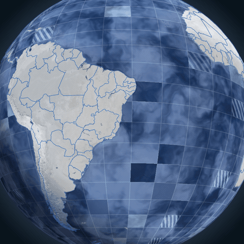

# vue-globe



Componente Vue 3 de um globo WebGL. O projeto que consome importa o componente, passa as regiões e decide o que fazer com hover e clique.

## Como usar

### 1. Instalar

O projeto precisa de Vue 3.5 ou mais recente. `three` entra junto com o componente.

```bash
npm install vue-globe three
```

### 2. Importar o componente e o CSS

```vue
<script setup>
import { Globe } from 'vue-globe'
import 'vue-globe/style.css'
</script>
```

O CSS é obrigatório. Sem ele o canvas não ocupa o elemento pai.

### 3. Dar largura e altura ao pai

O globo preenche o elemento em que está. Esse elemento precisa de tamanho.

```css
.mapa {
  width: 100%;
  height: 100dvh;
}
```

### 4. Colocar o globo na página

Países e estados já vêm no componente. `config` é opcional: passe só o que quiser mudar.

```vue
<template>
  <div class="mapa">
    <Globe :config="config" @region-click="onClick" />
  </div>
</template>

<script setup>
import { Globe } from 'vue-globe'
import 'vue-globe/style.css'

const config = {
  autoRotate: true,
  colors: {
    border: '#005696',
    fill: '#e1251b',
    ocean: '#214898',
  },
  camera: { lat: -18, lng: -58, distance: 5.35 },
}
</script>
```

### 5. Tratar o clique

O globo marca a região e entrega o evento. Navegação, painel ou qualquer outra ação ficam no seu projeto.

```vue
<script setup>
function onClick({ region, lat, lng }) {
  // region.id, region.name e region.data
  // lat e lng do ponto clicado
  console.log(region.name, lat, lng)
}
</script>

<template>
  <Globe @region-click="onClick" />
</template>
```

`@region-hover` recebe o mesmo objeto, ou `null` quando o ponteiro sai da região. `@pointer-miss` dispara ao clicar no oceano, fora de qualquer região.

```vue
<Globe
  @region-hover="onHover"
  @region-click="onClick"
  @pointer-miss="onMiss"
/>
```

### 6. Adicionar regiões próprias

`:regions` desenha polígonos extras por cima dos países. O clique testa essas regiões primeiro. As coordenadas seguem GeoJSON: `[longitude, latitude]`.

`data` volta no evento do clique, para você guardar o que o seu app precisa.

```vue
<script setup>
const regions = [
  {
    id: 'area-1',
    name: 'Área customizada',
    fill: '#e1251b',
    data: { rota: '/area-1' },
    geometry: {
      type: 'Polygon',
      coordinates: [
        [
          [-48.5, -1.4],
          [-48.3, -1.4],
          [-48.3, -1.2],
          [-48.5, -1.2],
          [-48.5, -1.4],
        ],
      ],
    },
  },
]

function onClick({ region }) {
  console.log(region.data)
}
</script>

<template>
  <Globe :regions="regions" @region-click="onClick" />
</template>
```

## O que dá para configurar

| Campo | Padrão | Efeito |
| --- | --- | --- |
| `autoRotate` | `true` | Gira a câmera sozinha |
| `rotateSpeed` | `0.12` | Velocidade da rotação, em radianos por segundo |
| `interactive` | `true` | Arrastar, hover e clique |
| `showLines` | `true` | Bordas dos países |
| `showGrid` | `true` | Grade sobre o oceano |
| `showAtmosphere` | `true` | Halo em volta do globo |
| `showClouds` | `true` | Nuvens no oceano |
| `showCells` | `true` | Células de hover |
| `lineOpacity` | `0.55` | Opacidade das bordas |
| `fillOpacity` | `0.55` | Opacidade do preenchimento |
| `gridOpacity` | `0.5` | Opacidade da grade |
| `colors` | ver abaixo | Cores do globo |
| `camera` | ver abaixo | Posição inicial da câmera |

Cores: `border` `#005696`, `fill` `#e1251b`, `hover` `#ffffff`, `land` `#fefefe`, `ocean` `#214898`, `grid` `#cedff3`, `atmosphere` `#83a6ce`, `background` `#061018`.

Câmera: `lat` `-18`, `lng` `-58`, `distance` `5.35`, `fov` `40`.

## Desenvolvimento

```bash
npm install
npm run dev
```

`npm run build` gera `dist/` para publicar ou ligar com `file:../vue-globe`.

## Licença

MIT. Veja o arquivo [LICENSE](./LICENSE).
